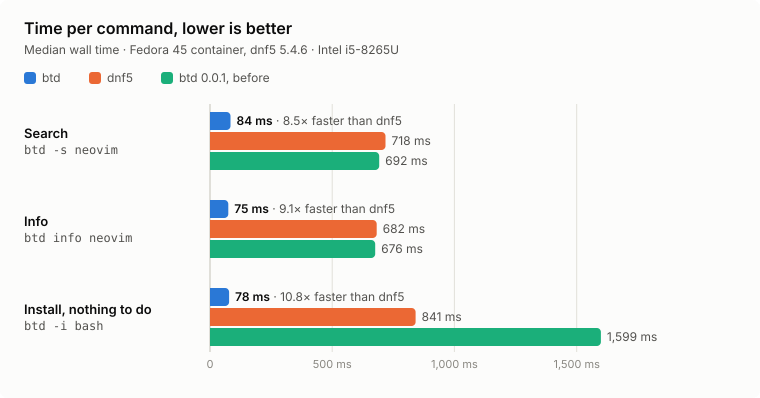
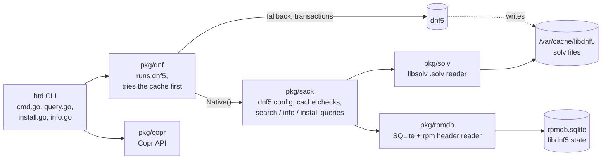

# Better Than DNF

[](https://github.com/bacteriafield/btd/actions/workflows/ci.yml)

BTD (Better Than DNF) - An RPM helper

btd wraps dnf5 on Fedora: one search over the enabled repositories and
[Copr](https://copr.fedorainfracloud.org), installs that enable the Copr
project a package needs, and queries answered about **9x faster than
dnf5**, with the same results, by reading dnf5's own cache directly.

<p align="center">
  
</p>

- [Install](#install)
- [Usage](#usage)
- [Benchmarks](#benchmarks)
- [How it works](#how-it-works)
- [Architecture](#architecture)
- [Development](#development)
- [Translations](#translations)

## Install

btd runs on Fedora only. From the latest GitHub release (x86_64):

```sh
git clone https://github.com/bacteriafield/btd && cd btd
./scripts/install.sh          # or a given version: ./scripts/install.sh 0.0.1
```

`scripts/deps.sh` installs what btd needs to run (dnf5 and dnf5-plugins);
`install.sh` calls it first.

From source:

```sh
./scripts/deps.sh --build     # adds golang, make and gettext
make PREFIX=/usr && sudo make install PREFIX=/usr
```

Quick install:

```sh
curl -fsSL https://raw.githubusercontent.com/bacteriafield/btd/main/scripts/install.sh | bash
```

Once the Copr project is published:

```sh
sudo dnf copr enable bacteriafield/btd
sudo dnf install btd
```

## Usage

```sh
btd                           # upgrade the system (dnf upgrade)
btd neovim                    # search, then pick numbers to install: 1 3 2-4
btd -s neovim                 # search only
btd info neovim               # dnf5 info, answered from the cache
btd -i obs-studio -y          # install, falling back to Copr
btd -i <owner/project/pkg>    # install pkg from that Copr project
btd -u / btd -r <pkg>         # upgrade / remove
btd list --installed          # any other dnf5 command is passed through
```

`btd --help` lists every option. Config lives in
`$XDG_CONFIG_HOME/btd/config.json` (`~/.config/btd/config.json`); every
field has a flag, and `--save` writes the flags you pass to it:

```sh
btd --save --no-bottom-up --sudo-bin run0
```

`--debug` prints every command and URL btd runs, and why it ran dnf5
instead of answering from the cache.

## Benchmarks

| Command | dnf5 | btd 0.0.1 | btd | btd vs dnf5 |
|---|---:|---:|---:|---:|
| Search: `btd -s neovim`, `dnf5 search neovim` | 718 ms | 692 ms | **84 ms** | 8.5x faster |
| Info: `btd info neovim`, `dnf5 info neovim` | 682 ms | 676 ms | **75 ms** | 9.1x faster |
| Install, nothing to do: `btd -i bash`, `dnf5 install bash` | 841 ms | 1,599 ms | **78 ms** | 10.8x faster |

Peak memory (max RSS) drops too: dnf5 uses 128 MB for search and info and
144 MB for the install; btd uses 80 MB for any of them.

btd 0.0.1 is the previous release, which ran `dnf5 repoquery` for its
searches and handed `info` and installs to dnf5, so it could only be as
fast as dnf5, or twice as slow for an install (a provides check, then
the install).

**How these were measured.** `go test -bench . -benchtime 10x -count 3
-short ./benchmark`, the code behind `make docker-bench`, in one
fedora:latest container (Fedora 45, dnf5 5.4.6, libsolv 0.7.41) on an
Intel i5-8265U under WSL2, for btd 0.0.1 and this version back to back.
Each command runs once untimed first, so dnf5's cache is warm. The table
shows medians: of 6 runs of 10 for dnf5, of 3 runs of 10 for each btd.
The search also queries Copr; the benchmark points it at a closed port
because Copr's API takes 10-17 s on Copr's side and dnf5 has nothing to
compare it with (`btd+copr`, skipped by `-short`).

To reproduce:

```sh
make docker-bench BENCHFLAGS=-short   # any machine with Docker
make bench BENCHFLAGS=-short          # on Fedora; the install benchmark needs root
```

CI runs the same benchmarks on every pull request and writes the table to
the job summary.

### Where the time goes

Before answering anything, dnf5 loads almost 70 shared libraries, rpm's
macros and its plugins, has librepo check every repository's metadata,
loads the whole rpmdb into libsolv, and reads each repository's solv
cache plus its updateinfo and comps extensions into libsolv's pool. Only
then does it look at the packages.

btd is a static Go binary that starts in about 6 ms. It reads the
configuration (2 ms), maps the solv files and parses them in parallel
(about 60 ms, nearly all of it Fedora's 31 MB file with 75,855 packages),
and decodes only what the query needs: name, version, arch and vendor
for every package, everything else for the packages that matched. From
the rpmdb it reads the small index tables and the headers of the
packages it needs, not the whole database.

## How it works

| You run | btd does |
|---|---|
| `btd -s term`, `btd term` | searches package names in dnf5's cache and Copr at once, then lets you pick |
| `btd info spec...` | answers from dnf5's cache, printing exactly what `dnf5 info` prints |
| `btd -i pkg` | checks the cache for a provider, else Copr; skips dnf5 when everything is already installed; otherwise runs `dnf5 install` |
| `btd`, `-u`, `-r` | runs `dnf5 upgrade` / `remove` |
| any other dnf5 command | hands it to dnf5 as is |

- **Reads come from dnf5's own cache, writes go through dnf5.** btd never
  changes the system itself: installs, upgrades and removals are dnf5
  transactions. btd never kills dnf; Ctrl+C reaches dnf from the terminal
  and btd keeps dnf's exit code.
- **Copr is btd's AUR.** btd builds nothing: Copr projects ship ready
  RPMs, and btd enables them with `dnf copr enable`.
- **Official repositories first.** `btd install foo` uses the enabled
  repositories when anything provides `foo` (names and capabilities such
  as `pkgconfig(gtk4)`); only then does it search Copr.
- **Enabling a Copr project asks first, defaulting to no.** Once enabled,
  a third-party repository can replace any package on upgrades.
- **`-y` never picks a Copr project.** It answers yes/no questions; to
  install from Copr unattended, name the project: `owner/project/pkg`.
- **One transaction.** Copr projects are enabled first, then all targets
  go to a single `dnf install`.
- **Copr results** are projects built for this system's chroot
  (`fedora-<release>-<arch>`), ranked by exact name, then name containing
  the term. Copr's search API takes 10-17s, so it runs alongside the
  repository search.
- **Privileges**: only dnf transactions are elevated, with `BTD_SUDO`
  or `sudo_bin`, falling back to sudo, run0, doas and pkexec. A no-op
  install needs no elevation at all.

### Reading dnf5's cache

Whenever dnf5 refreshes a repository, it stores the parsed metadata as a
libsolv file, `/var/cache/libdnf5/<repo>-<hash>/solv/<repo>.solv` (users
get their own copy under `~/.cache/libdnf5`). btd reads those files, the
rpmdb and dnf5's system state, and uses them only when they are exactly
what dnf5 would use, checked the way libdnf5 checks them:

| What | Where | Checked like |
|---|---|---|
| main options | `/usr/share/dnf5/libdnf.conf.d/*.conf`, `/etc/dnf/libdnf5.conf.d/*.conf`, `/etc/dnf/dnf.conf` | `Base::load_config`: drop-ins sorted by name, then dnf.conf |
| repositories | `/etc/yum.repos.d`, `/etc/distro.repos.d`, `/usr/share/dnf5/repos.d`, plus `repos.override.d` | `RepoSack`: first definition of an id wins, overrides by id glob |
| variables | `/usr/share/dnf5/vars.d`, `/etc/dnf/vars`, `DNF_VAR_*`, arch, releasever from the rpmdb | `Vars::load`, `detect_releasevers` |
| cache directory | `<id>-` + 8 bytes of SHA-256 of the metalink, mirrorlist or first baseurl | `ConfigRepo::get_unique_id` |
| freshness | the primary file's age against `metadata_expire`, the `attrs/expired` marker, the .repo file's age | `Repo::recompute_expired` |
| solv file | its userdata holds SHA-256 of `"H000"` + repomd.xml | `SolvRepo::can_use_solvfile_cache` |
| installed packages | `/usr/lib/sysimage/rpm/rpmdb.sqlite` | as libsolv reads the rpmdb (`repo_rpmdb.c`) |
| install reasons, origins | `/usr/lib/sysimage/libdnf5/packages.toml`, `nevras.toml` | `system::State` |

**When btd runs dnf5 instead.** Any doubt means dnf5 answers, which also
refreshes the cache for the next time:

- a repository cache is missing, expired or does not match its repomd.xml;
- the configuration excludes or includes packages, uses modules,
  versionlock, an installroot or another cache directory;
- the rpmdb has an unflushed write-ahead log (rpm is writing to it);
- `info` gets options, or specs dnf5 could read as `name.arch`,
  `name-version` or a NEVRA glob; `install` gets options, globs, or
  packages that are not all installed with a recorded reason;
- `best=True` is set (Fedora ships `best=False`), since dnf5 would then
  upgrade an installed package on `install`.

**Same answers as dnf5.** `btd info` resolves specs and filters packages
like `dnf5/commands/list/list.cpp` (case-insensitive names, repository
priority, latest version, not older than the installed one) and prints
like libsmartcols prints dnf5's tables: the same column widths, sizes,
`\xNN` escaping in the C locale, wrapping and colors on a terminal, and
labels from dnf5's own translation catalogs, so they come out in your
language. The output was compared byte for byte with `dnf5 info` over
170,000 lines (`python3-*`, `lib*`, `glibc*`), and CI repeats the
comparison on every pull request (`benchmark/compat_test.go`).

## Architecture



| Package | Role |
|---|---|
| `main` | command line: flags, command dispatch, search menu, Copr fallback, `info` output |
| `pkg/dnf` | runs dnf5 (queries as the user, transactions elevated); `Native()` loads the cache once, or returns nil so callers fall back to dnf5 |
| `pkg/sack` | reads dnf5's configuration and validates its caches, then answers `Search`, `Provided`, `Info` and `AlreadyInstalled`; also rpm version comparison (`rpmvercmp`) |
| `pkg/solv` | port of libsolv's `repo_add_solv` (solv format 8 and 9): string pool, relations, schemata, incore data and compressed vertical pages, all bounds checked |
| `pkg/rpmdb` | read-only SQLite table reader (b-trees, overflow pages, records) and rpm header parser, without librpm |
| `pkg/copr` | Copr API v3: project search for this system's chroot, package lists |
| `pkg/menu` | numbered result lists and selections like `1 3 2-4` |
| `pkg/settings` | `config.json`, defaults, privilege elevator |
| `benchmark` | benchmarks against dnf5 and the compatibility tests |

Everything is Go with one dependency (gotext, for translations) and no
cgo: btd links neither libsolv nor librpm, so releases stay a single
static binary.

## Development

```sh
make test                         # go test ./...; dnf5-dependent tests skip outside Fedora
make docker-test                  # every test, in a Fedora container as root
make bench                        # btd against dnf5, on Fedora
make docker-bench                 # the same in a Fedora container
golangci-lint run                 # .golangci.yml
docker build -t btd . && docker run --rm -it btd   # Fedora box with btd
```

`BENCHFLAGS=-short` skips the Copr search. The install benchmark and test
need root, so outside Fedora they run in the container only.

CI ([`.github/workflows/ci.yml`](.github/workflows/ci.yml)) runs on pull
requests and pushes to main:

| Job | Runs |
|---|---|
| lint | gofmt, go vet, golangci-lint |
| test | `go test -race ./...` on Ubuntu |
| fedora | in a fedora:latest container as root: every test, including the comparisons with dnf5, then the benchmarks, summarized in the job |

## Translations

`po/btd.pot` is the template; regenerate it after changing messages:

```sh
make pot
msgmerge -U po/pt_BR.po po/btd.pot   # per language
```

The shipped translations were machine-made and keep every format verb
(`%s`, `%[1]s`); native speakers are welcome to review them. The `info`
output and dnf5's messages that btd reproduces use dnf5's own catalogs.
