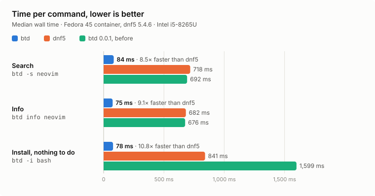

# Guide

btd wraps dnf5 on Fedora: one search over the enabled repositories and
[Copr](https://copr.fedorainfracloud.org), installs that enable the Copr
project a package needs, and queries answered about **9x faster than
dnf5**, with the same results, by reading dnf5's own cache directly.

## Install

btd runs on Fedora only. Quick install, from the latest GitHub release
(x86_64):

```sh
curl -fsSL https://raw.githubusercontent.com/bacteriafield/btd/main/scripts/install.sh | bash
```

Or from a clone:

```sh
git clone https://github.com/bacteriafield/btd && cd btd
./scripts/install.sh          # or a given version: ./scripts/install.sh 0.0.1
```

`scripts/deps.sh` installs what btd needs to run (dnf5 and dnf5-plugins);
`install.sh` calls it first.

From source:

```sh
./scripts/deps.sh --build     # adds golang, make and gettext
make PREFIX=/usr && sudo make install PREFIX=/usr
```

Once the Copr project is published:

```sh
sudo dnf copr enable bacteriafield/btd
sudo dnf install btd
```

## Usage

```sh
btd                           # upgrade the system (dnf upgrade)
btd neovim                    # search, then pick numbers to install: 1 3 2-4
btd -s neovim                 # search only
btd info neovim               # dnf5 info, answered from the cache
btd -i obs-studio -y          # install, falling back to Copr
btd -i <owner/project/pkg>    # install pkg from that Copr project
btd -u / btd -r <pkg>         # upgrade / remove
btd list --installed          # any other dnf5 command is passed through
```

`btd --help` lists every option.

### Configuration

Config lives in `$XDG_CONFIG_HOME/btd/config.json`
(`~/.config/btd/config.json`); every field has a flag, and `--save`
writes the flags you pass to it:

```sh
btd --save --no-bottom-up --sudo-bin run0
```

`--debug` prints every command and URL btd runs, and why it ran dnf5
instead of answering from the cache.

## Benchmarks



| Command | dnf5 | btd 0.0.1 | btd | btd vs dnf5 |
|---|---:|---:|---:|---:|
| Search: `btd -s neovim` | 718 ms | 692 ms | **84 ms** | 8.5x faster |
| Info: `btd info neovim` | 682 ms | 676 ms | **75 ms** | 9.1x faster |
| Install, nothing to do: `btd -i bash` | 841 ms | 1,599 ms | **78 ms** | 10.8x faster |

Peak memory (max RSS) drops too: dnf5 uses 128 MB for search and info and
144 MB for the install; btd uses 80 MB for any of them.

::: details How these were measured
`go test -bench . -benchtime 10x -count 3 -short ./benchmark`, the code
behind `make docker-bench`, in one fedora:latest container (Fedora 45,
dnf5 5.4.6, libsolv 0.7.41) on an Intel i5-8265U under WSL2, for btd
0.0.1 and this version back to back. Each command runs once untimed
first, so dnf5's cache is warm. The table shows medians: of 6 runs of 10
for dnf5, of 3 runs of 10 for each btd. The search also queries Copr; the
benchmark points it at a closed port because Copr's API takes 10-17 s on
Copr's side and dnf5 has nothing to compare it with.
:::

To reproduce:

```sh
make docker-bench BENCHFLAGS=-short   # any machine with Docker
make bench BENCHFLAGS=-short          # on Fedora; the install benchmark needs root
```

Why it's faster is on [How it works](./how-it-works#where-the-time-goes).
